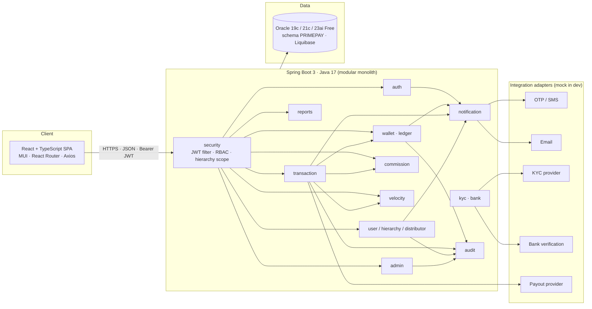

# PrimePay architecture

PrimePay is a multi-level wallet and distributor platform. It is built as a **modular monolith**: one Spring Boot application and one Oracle schema, split into modules with clear boundaries so any module can later be extracted into its own service.

## System overview



### Request path

1. The SPA sends `Authorization: Bearer <access token>`.
2. `security` validates the JWT, loads the user, and rejects inactive, suspended or locked accounts on every request.
3. The controller validates the input (Bean Validation) and calls one service method.
4. The service checks **permission** (what the role may do) and **hierarchy scope** (whether the target is the caller or below them) before reading or writing.
5. Financial services run inside one database transaction with row locks on the wallets involved. They write the business record, ledger entries, status history and audit entry together.
6. Responses use the standard envelope described below. Errors go through one global handler.

## Modules

| Module | Owns | Phase |
|---|---|---|
| `config` | Jackson, OpenAPI, JPA auditing, CORS, Liquibase | 1 |
| `security` | JWT issue/verify, filter chain, `CurrentUser`, permission and scope checks | 1, 3 |
| `common` | API envelope, paging, error codes, exceptions, base entities, reference generator | 1 |
| `auth` | login, refresh rotation, logout, forgot/reset password, change password, lockout | 1 (login, me), 3 |
| `user` | users, profiles, status lifecycle | 1 (moved), 4 |
| `hierarchy` | parent/child links, closure queries, scope checks | 2 |
| `distributor` | 5-step onboarding wizard and approval | 1 (moved), 4 |
| `kyc`, `bank` | KYC and bank details, verification adapters | 4 |
| `wallet`, `ledger` | wallets, balance changes through ledger entries only | 6 |
| `transaction` | transaction lifecycle, idempotency, reversals | 7 |
| `commission` | rules, slabs, distribution, statements | 8 |
| `velocity` | limits configuration and enforcement | 9 |
| `reports` | dashboards, reports, exports | 5, 10 |
| `notification` | in-app, email, SMS through provider interfaces | 4+ |
| `audit` | append-only audit log | 1 (base), 3+ |
| `admin` | roles, permissions, services, system settings, templates | 3, 10 |

Rules that keep modules separable:

- A module calls another only through its public service interfaces, never its repositories.
- Entities don't hold JPA references across modules; they store the other module's ID.
- Each module has its own Liquibase changelog folder.

## Backend layout

```
backend/
  pom.xml
  src/main/java/com/primepay/
    PrimePayApplication.java
    config/        OpenApiConfig, LiquibaseConfig, JpaAuditingConfig, JacksonConfig
    security/      SecurityConfig, JwtConfig, CurrentUserService
    common/
      api/         ApiResponse, PageResponse, ApiError
      error/       ErrorCode, BusinessException, GlobalExceptionHandler
      persistence/ AuditableEntity
    auth/          AuthController, AuthService, DevAdminBootstrap, dto/
    user/          AccountController, AccountService, entities, repositories, dto/
    distributor/   onboarding controller, service, OTP adapter
    hierarchy/ kyc/ bank/ wallet/ ledger/ transaction/ commission/
    velocity/ reports/ notification/ audit/ admin/   (added in their phases)
  src/main/resources/
    application.properties, application-dev.properties, application-oracle.properties
    db/changelog/db.changelog-master.xml (+ one folder per module)
  src/test/java/com/primepay/...
```

Each module uses the same internal layout: `controller`, `service`, `repository`, `entity`, `dto`, `mapper` (MapStruct) and `validator`, created as the module needs them. Controllers stay thin: they validate input, call one service method and wrap the result.

## Frontend layout

```
frontend/
  src/
    app/router/          route table, RequireAuth, RequireRole
    app/providers/       ThemeProvider, AuthProvider, QueryClient (later)
    components/common/   PageHeader, EmptyState, StatusChip, Logo
    components/layout/   AppLayout, Sidebar, Topbar
    components/forms/ tables/ charts/   (filled from Phase 4)
    layouts/             AuthLayout
    pages/auth/ dashboard/ users/ distributors/ hierarchy/ wallets/
          transactions/ commissions/ reports/ settings/
    services/            apiClient (Axios), authService
    hooks/ context/ types/ utils/ validation/
    theme/               design tokens and MUI theme
```

Navigation is generated from one config listing each item's route, allowed roles and phase status. Only implemented screens appear, so the app never shows buttons that do nothing.

## API conventions

Base path `/api/v1`. JSON only, except file uploads (multipart).

Success envelope:

```json
{ "success": true, "data": { }, "message": null, "timestamp": "2026-11-26T10:42:18Z", "requestId": "b1f0…" }
```

Paged data is returned as `data: { "items": [], "page": 0, "size": 20, "totalItems": 248, "totalPages": 13 }`.

Error envelope (same shape, `success: false`):

```json
{ "success": false, "error": { "code": "INSUFFICIENT_BALANCE", "message": "…", "fields": [ { "field": "amount", "message": "…" } ] }, "timestamp": "…", "requestId": "…" }
```

| HTTP | When |
|---|---|
| 200 / 201 | Read / created |
| 400 | Validation failed (`VALIDATION_FAILED`) |
| 401 | Missing or invalid token (`UNAUTHENTICATED`) |
| 403 | Permission or hierarchy scope denied (`ACCESS_DENIED`, `OUTSIDE_HIERARCHY`) |
| 404 | Not found, or outside the caller's scope when existence must not leak |
| 409 | Duplicate or state conflict (`DUPLICATE`, `INVALID_STATE`, `IDEMPOTENCY_CONFLICT`) |
| 422 | Business rule refused (`INSUFFICIENT_BALANCE`, `LIMIT_EXCEEDED`, `ACCOUNT_INACTIVE`) |
| 423 | Account locked |
| 429 | Rate limited |

Every financial `POST` requires an `Idempotency-Key` header (UUID). The full endpoint list is in [api-contracts.md](api-contracts.md).

## Environments

| Profile | Database | Purpose |
|---|---|---|
| `dev` | H2 in Oracle compatibility mode, in memory | Fast local start with no Docker. Mock adapters. Resets on restart. |
| `oracle` | Oracle via `SPRING_DATASOURCE_*` | Local Docker Oracle (`docker compose up oracle`) or shared environments. |
| `test` | H2 (unit/slice) | Test suite. Oracle-specific checks run against the `oracle` profile once Docker is available. |

Oracle is the database of record. H2 exists only so the app starts without Docker. Every migration is written for Oracle first, and any H2 variant is marked `dbms:h2`.
