# Oracle database design

Target: Oracle 19c / 21c (local development on Oracle 23ai Free in Docker). Schema `PRIMEPAY`, managed only by Liquibase. Hibernate runs with `ddl-auto=validate`, so it never changes the schema.

## Conventions

| Item | Rule |
|---|---|
| Table names | `PP_` prefix, plural, upper snake case |
| Primary keys | `ID NUMBER(19) GENERATED BY DEFAULT AS IDENTITY` |
| Money | `NUMBER(19,2)`. Never `FLOAT`, `BINARY_DOUBLE` or Java `double`; Java uses `BigDecimal` with `RoundingMode.HALF_UP`. |
| Rates | `NUMBER(9,6)` (percent, e.g. `0.100000` = 0.10%) |
| Booleans | `NUMBER(1)` with `CHECK (col IN (0,1))` |
| Timestamps | `TIMESTAMP WITH TIME ZONE`, stored in UTC; business day boundaries use `Asia/Kolkata` |
| Status columns | `VARCHAR2(30 CHAR)` with a `CHECK` constraint listing allowed values |
| Audit columns | `CREATED_AT`, `CREATED_BY`, `UPDATED_AT`, `UPDATED_BY`, `VERSION NUMBER(10)` (optimistic lock) on every mutable table |
| Constraint names | `PK_<table>`, `FK_<table>_<col>`, `UQ_<table>_<cols>`, `CK_<table>_<col>`, `IX_<table>_<cols>` |
| Sensitive data | Aadhaar and bank account numbers: encrypted column plus `_LAST4` for display. Full values never appear in logs or API responses. OTPs are stored only as hashes. |
| Immutability | `PP_WALLET_LEDGER`, `PP_TRANSACTION_STATUS_HISTORY` and `PP_AUDIT_LOGS` are insert-only. The application user gets no `UPDATE`/`DELETE` on them; a trigger also rejects both. |

## ER diagram (core)

```mermaid
erDiagram
  PP_USERS ||--|| PP_USER_PROFILES : has
  PP_USERS ||--o{ PP_USER_ROLES : has
  PP_ROLES ||--o{ PP_USER_ROLES : grants
  PP_ROLES ||--o{ PP_ROLE_PERMISSIONS : has
  PP_PERMISSIONS ||--o{ PP_ROLE_PERMISSIONS : in
  PP_USERS ||--o{ PP_USER_HIERARCHY : "ancestor of"
  PP_USERS ||--o{ PP_USER_STATUS_HISTORY : has
  PP_USERS ||--o| PP_KYC_DETAILS : has
  PP_USERS ||--o{ PP_BANK_DETAILS : has
  PP_USERS ||--o{ PP_USER_DOCUMENTS : uploads
  PP_USERS ||--o{ PP_USER_AGREEMENTS : accepts
  PP_AGREEMENTS ||--o{ PP_USER_AGREEMENTS : versions
  PP_USERS ||--o| PP_WALLETS : owns
  PP_WALLETS ||--o{ PP_WALLET_LEDGER : entries
  PP_WALLETS ||--o{ PP_WALLET_BALANCE_HISTORY : snapshots
  PP_TRANSACTIONS ||--o{ PP_WALLET_LEDGER : posts
  PP_TRANSACTIONS ||--o| PP_TRANSACTION_DETAILS : details
  PP_TRANSACTIONS ||--o{ PP_TRANSACTION_STATUS_HISTORY : history
  PP_TRANSACTIONS ||--o| PP_WALLET_TRANSFERS : "is a"
  PP_TRANSACTIONS ||--o| PP_WALLET_ADJUSTMENTS : "is a"
  PP_TRANSACTIONS ||--o{ PP_TRANSACTION_REVERSALS : reversed_by
  PP_TRANSACTIONS ||--o| PP_TRANSACTION_IDEMPOTENCY : keyed_by
  PP_TRANSACTIONS ||--o{ PP_COMMISSION_TRANSACTIONS : earns
  PP_COMMISSION_CONFIG ||--o{ PP_COMMISSION_RULES : contains
  PP_COMMISSION_RULES ||--o{ PP_COMMISSION_DISTRIBUTION : "level shares"
  PP_COMMISSION_TRANSACTIONS }o--|| PP_USERS : earner
  PP_SERVICE_MASTER ||--o{ PP_TRANSACTIONS : service
  PP_SERVICE_MASTER ||--o{ PP_COMMISSION_RULES : for
  PP_SERVICE_MASTER ||--o{ PP_TRANSACTION_LIMITS : for
  PP_VELOCITY_CONFIG ||--o{ PP_TRANSACTION_LIMITS : contains
  PP_USERS ||--o{ PP_DAILY_TRANSACTION_SUMMARY : usage
  PP_USERS ||--o{ PP_MONTHLY_TRANSACTION_SUMMARY : usage
  PP_USERS ||--o{ PP_LOGIN_HISTORY : logins
  PP_USERS ||--o{ PP_NOTIFICATIONS : receives
  PP_USERS ||--o{ PP_OTP_VERIFICATIONS : requests
  PP_USERS ||--o{ PP_AUDIT_LOGS : actor

  PP_USERS {
    NUMBER ID PK
    VARCHAR2 USER_CODE UK "PP-DT-3307"
    VARCHAR2 USERNAME UK
    VARCHAR2 EMAIL UK
    VARCHAR2 MOBILE UK
    VARCHAR2 PASSWORD_HASH "BCrypt"
    VARCHAR2 ROLE_CODE
    NUMBER PARENT_ID FK
    VARCHAR2 STATUS "DRAFT..ACTIVE"
    NUMBER FAILED_LOGINS
    TIMESTAMP LOCKED_UNTIL
  }
  PP_USER_HIERARCHY {
    NUMBER ANCESTOR_ID FK
    NUMBER DESCENDANT_ID FK
    NUMBER DEPTH "closure table"
  }
  PP_WALLETS {
    NUMBER ID PK
    VARCHAR2 WALLET_CODE UK
    NUMBER USER_ID FK
    NUMBER AVAILABLE_BALANCE "19,2"
    NUMBER LEDGER_BALANCE "19,2"
    NUMBER BLOCKED_BALANCE "19,2"
    NUMBER TOTAL_CREDIT "19,2"
    NUMBER TOTAL_DEBIT "19,2"
    VARCHAR2 STATUS
    NUMBER VERSION
  }
  PP_WALLET_LEDGER {
    NUMBER ID PK
    VARCHAR2 ENTRY_REF UK
    NUMBER WALLET_ID FK
    NUMBER TRANSACTION_ID FK
    VARCHAR2 DIRECTION "DR or CR"
    NUMBER AMOUNT "19,2"
    NUMBER BALANCE_BEFORE "19,2"
    NUMBER BALANCE_AFTER "19,2"
    TIMESTAMP CREATED_AT
  }
  PP_TRANSACTIONS {
    NUMBER ID PK
    VARCHAR2 REFERENCE_NO UK "PPT..."
    VARCHAR2 TXN_TYPE
    VARCHAR2 STATUS
    NUMBER INITIATOR_USER_ID FK
    NUMBER SOURCE_WALLET_ID FK
    NUMBER TARGET_WALLET_ID FK
    NUMBER AMOUNT "19,2"
    NUMBER FEE "19,2"
    NUMBER SERVICE_ID FK
    NUMBER ORIGINAL_TXN_ID FK "for reversals"
  }
  PP_TRANSACTION_IDEMPOTENCY {
    VARCHAR2 IDEMPOTENCY_KEY PK
    NUMBER USER_ID
    VARCHAR2 REQUEST_HASH
    NUMBER TRANSACTION_ID FK
    TIMESTAMP EXPIRES_AT
  }
  PP_COMMISSION_RULES {
    NUMBER ID PK
    VARCHAR2 RULE_CODE UK
    NUMBER SERVICE_ID FK
    VARCHAR2 CALC_TYPE "PERCENT FIXED SLAB"
    NUMBER SLAB_FROM "19,2"
    NUMBER SLAB_TO "19,2"
    DATE EFFECTIVE_FROM
    DATE EFFECTIVE_TO
  }
  PP_COMMISSION_DISTRIBUTION {
    NUMBER RULE_ID FK
    VARCHAR2 LEVEL_ROLE
    NUMBER RATE "9,6"
    NUMBER FIXED_AMOUNT "19,2"
    NUMBER MIN_AMOUNT "19,2"
    NUMBER MAX_AMOUNT "19,2"
  }
  PP_TRANSACTION_LIMITS {
    NUMBER ID PK
    VARCHAR2 SCOPE "ROLE or USER"
    VARCHAR2 ROLE_CODE
    NUMBER USER_ID FK
    NUMBER SERVICE_ID FK
    NUMBER MIN_TXN "19,2"
    NUMBER MAX_TXN "19,2"
    NUMBER DAILY_AMOUNT "19,2"
    NUMBER MONTHLY_AMOUNT "19,2"
    NUMBER DAILY_COUNT
    NUMBER MONTHLY_COUNT
  }
  PP_DAILY_TRANSACTION_SUMMARY {
    NUMBER USER_ID FK
    DATE BUSINESS_DATE "IST"
    NUMBER SERVICE_ID FK
    NUMBER TXN_COUNT
    NUMBER TXN_AMOUNT "19,2"
  }
  PP_AUDIT_LOGS {
    NUMBER ID PK
    TIMESTAMP OCCURRED_AT
    NUMBER ACTOR_USER_ID
    VARCHAR2 ACTION
    VARCHAR2 TARGET_TYPE
    VARCHAR2 TARGET_ID
    CLOB BEFORE_JSON
    CLOB AFTER_JSON
    VARCHAR2 IP_ADDRESS
    VARCHAR2 REQUEST_ID
  }
```

## Table catalogue

| Area | Table | Purpose | Key constraints and indexes |
|---|---|---|---|
| Identity | `PP_USERS` | Login identity, role, parent, status | UQ user_code, username, email, mobile; IX parent_id, (role_code, status) |
| | `PP_ROLES`, `PP_PERMISSIONS`, `PP_ROLE_PERMISSIONS`, `PP_USER_ROLES` | Permission-based authorization | UQ codes; composite PKs on join tables |
| | `PP_USER_HIERARCHY` | Closure table (ancestor, descendant, depth) for O(1) scope checks | PK (ancestor_id, descendant_id); IX descendant_id |
| | `PP_USER_PROFILES` | Name, business, address, photo reference | UQ user_id |
| | `PP_USER_DOCUMENTS` | Uploaded files (photo, KYC proofs) as storage references | IX user_id |
| | `PP_KYC_DETAILS` | Encrypted Aadhaar/PAN, last-4, DOB, verification status | UQ user_id; UQ pan_hash |
| | `PP_BANK_DETAILS` | Encrypted account number, last-4, IFSC, verification result | IX user_id; one primary per user |
| | `PP_USER_STATUS_HISTORY` | Every status change with actor and reason | IX (user_id, changed_at) |
| Wallet | `PP_WALLETS` | One wallet per business user; balances changed only by the ledger service | UQ user_id, wallet_code; CK balances ≥ 0 unless allowed |
| | `PP_WALLET_LEDGER` | Immutable double-entry lines | UQ entry_ref; IX (wallet_id, created_at), transaction_id |
| | `PP_WALLET_TRANSFERS` | Sender, receiver and hierarchy check result for each transfer | UQ transaction_id |
| | `PP_WALLET_ADJUSTMENTS` | Maker-checker manual credit/debit | CK maker ≠ checker |
| | `PP_WALLET_BALANCE_HISTORY` | Daily closing snapshot per wallet | UQ (wallet_id, business_date) |
| Transactions | `PP_TRANSACTIONS` | Every financial operation | UQ reference_no; IX (initiator, created_at), (status, created_at) |
| | `PP_TRANSACTION_DETAILS` | Service-specific fields (beneficiary, UTR, provider response) | UQ transaction_id |
| | `PP_TRANSACTION_STATUS_HISTORY` | Every state transition | IX transaction_id |
| | `PP_TRANSACTION_REVERSALS` | Original and reversal transaction links with reason | UQ original_txn_id |
| | `PP_TRANSACTION_IDEMPOTENCY` | Idempotency key → result | PK key; IX expires_at |
| Commission | `PP_COMMISSION_CONFIG` | Versioned rule set per service | |
| | `PP_COMMISSION_RULES` | Calculation type, slab range, effective dates | No overlapping (service, slab, date) ranges (checked in service) |
| | `PP_COMMISSION_DISTRIBUTION` | Share per hierarchy level | PK (rule_id, level_role) |
| | `PP_COMMISSION_TRANSACTIONS` | One row per earner per transaction | IX (earner_user_id, created_at), transaction_id |
| Limits | `PP_VELOCITY_CONFIG`, `PP_TRANSACTION_LIMITS` | Role and user limits, per service | UQ (scope, role/user, service) |
| | `PP_DAILY_TRANSACTION_SUMMARY`, `PP_MONTHLY_TRANSACTION_SUMMARY` | Usage counters updated in the same database transaction | PK (user_id, period, service_id); row locked during the check |
| Other | `PP_OTP_VERIFICATIONS` | OTP hash, purpose, attempts, expiry | IX (target, purpose, created_at) |
| | `PP_NOTIFICATIONS` | In-app, email and SMS records with delivery status | IX (user_id, read_at) |
| | `PP_AUDIT_LOGS` | Append-only audit trail | IX (actor, occurred_at), (target_type, target_id) |
| | `PP_LOGIN_HISTORY` | Sign-in attempts, IP, device, result | IX (user_id, attempted_at) |
| | `PP_SYSTEM_CONFIG` | Key/value settings | UQ config_key |
| | `PP_SERVICE_MASTER` | Services and their transaction types | UQ service_code |
| | `PP_AGREEMENTS`, `PP_USER_AGREEMENTS` | Agreement versions and acceptances | UQ (agreement_id, version) |
| Auth | `PP_REFRESH_TOKENS` | Hashed refresh tokens with family ID for rotation and reuse detection (added beyond the spec list) | UQ token_hash; IX (user_id, family_id) |

## Migration plan

- **Phase 1** keeps today's three tables (`agent_account`, `account_user`, `distributor_onboarding`) so existing login, hierarchy and onboarding keep working.
- **Phase 2** adds the `PP_` schema in new changesets, copies the existing rows into `PP_USERS`, `PP_USER_HIERARCHY` and `PP_USER_PROFILES`, and moves the code onto the new entities. The old tables are dropped in a later changeset once nothing reads them.
- Changesets are never edited after they've run anywhere shared; corrections are new changesets.
