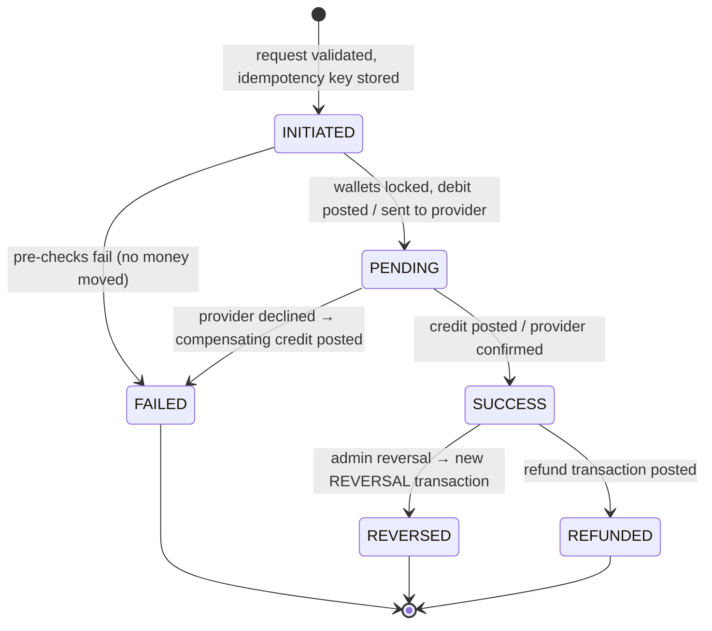

# Financial transaction lifecycles

Simulated in development: no real money moves until an approved provider is connected with sandbox, then production, credentials. Every screen and receipt from a mock provider is labelled "Simulated".

## Transaction states



Allowed transitions live in one `TransactionStateMachine`. Any other transition throws `INVALID_STATE` (409). Every transition writes `PP_TRANSACTION_STATUS_HISTORY` and an audit row in the same database transaction.

Internal wallet transfers (sender and receiver both PrimePay wallets) go INITIATED → SUCCESS inside one database transaction; PENDING is only used when an external provider is involved.

## Wallet transfer (Super → Master → Distributor → Retailer)

```mermaid
sequenceDiagram
  participant UI
  participant API as TransferController
  participant S as WalletTransferService
  participant V as VelocityService
  participant DB as Oracle
  UI->>API: POST /wallets/transfer (Idempotency-Key)
  API->>S: transfer(actor, toUserId, amount, key)
  S->>DB: find idempotency key
  alt key seen with same request hash
    S-->>API: return the original result (no second debit)
  else new key
    S->>DB: BEGIN
    S->>DB: check sender active; receiver is a direct child and active
    S->>DB: SELECT wallets FOR UPDATE (lowest wallet ID first)
    S->>V: check and record limits (locks the usage row)
    S->>DB: check available ≥ amount + fee
    S->>DB: INSERT PP_TRANSACTIONS (SUCCESS), ledger DR sender, ledger CR receiver
    S->>DB: UPDATE both wallet balances (version check)
    S->>DB: INSERT transfer, status history, audit, idempotency result
    S->>DB: COMMIT
  end
  S-->>UI: 201 with reference PPT…
```

Guarantees:

- **Atomic:** both ledger lines and both balance updates commit together or not at all (scenario 13).
- **No double debit:** the idempotency key is unique per user. Repeating the same key and body returns the first result; the same key with a different body returns 409 `IDEMPOTENCY_CONFLICT` (scenario 14).
- **No deadlocks:** wallets are always locked in ascending ID order.
- **No negative balance:** checked under the row lock, and backed by a `CHECK` constraint.
- **Ledger invariant:** for every transaction, Σ debits = Σ credits, and every wallet balance equals the sum of its ledger lines. Daily reconciliation verifies both.

## Service transaction (e.g. Retailer payout)

1. **INITIATED**: validate the request and run the velocity checks (account status, wallet status, min/max, daily and monthly amount and count, hierarchy, risk rules).
2. **PENDING**: debit amount plus fee from the Retailer wallet (ledger DR) and call the payout adapter.
3. Provider result:
   - **SUCCESS**: run the commission engine, which posts one ledger CR per earning level and writes `PP_COMMISSION_TRANSACTIONS`.
   - **FAILED**: post a compensating ledger CR for amount plus fee, and mark the transaction FAILED.
4. Pending items older than the SLA are picked up by the status-enquiry job and the daily reconciliation.

## Reversal

- **Who:** only Platform Admin (`TXN_REVERSE`), and only for a SUCCESS transaction within the configured window.
- **What it creates:** a new `REVERSAL` transaction with its own reference, linked through `PP_TRANSACTION_REVERSALS`, whose ledger lines mirror the original's.
- **Commission:** every commission share is reversed with its own entry.
- **Original records:** never updated or deleted, apart from the status moving to REVERSED.
- **When it's refused:** if a receiving wallet no longer has the funds, the reversal fails with `INSUFFICIENT_BALANCE`, unless the admin chooses a recovery adjustment instead.

## Reference numbers

`PP` + type letter (`T` transaction, `R` reversal, `A` adjustment, `C` commission) + `yyMMdd` + 7-digit Oracle sequence, for example `PPT2611260000401`. Oracle sequences mean the numbers are unique across nodes.

## Commission calculation

For each eligible SUCCESS transaction, the engine:

1. Finds the active rule for (service, amount slab, business date).
2. Walks from the transacting user up to the platform.
3. For each level, calculates `rate × amount`, or the fixed amount, clamped to that level's min and max and rounded half-up to 2 decimals.
4. Writes each component separately.

Nothing is hardcoded; the example rates (0.10 / 0.20 / 0.15 / 0.10 / 0.05 %) are seed data only.
