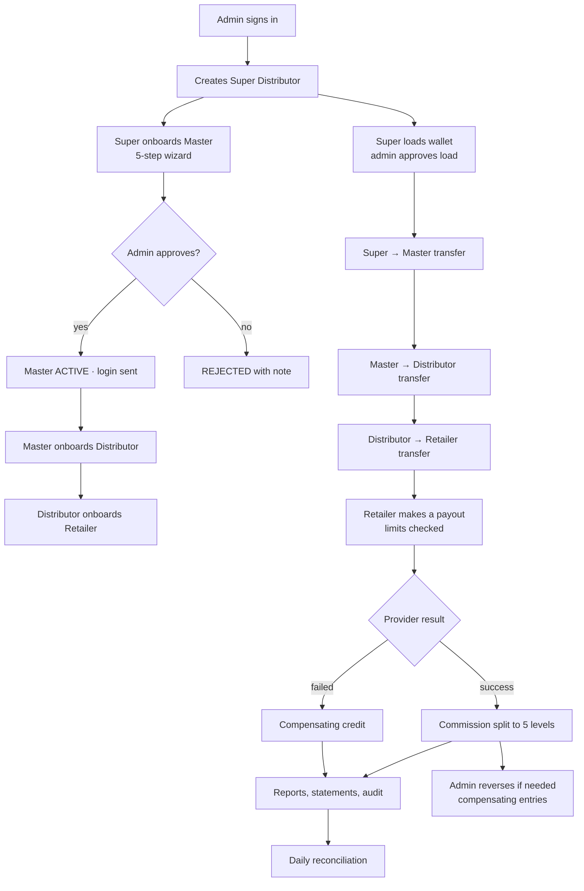

# Roadmap, screen inventory and user journeys

## Phases

| # | Phase | Delivers | Status |
|---|---|---|---|
| 1 | Foundation | Maven backend in `com.primepay.*` modules, API envelope and global error handling, JPA auditing base, `/auth/me`, generated dev password, TypeScript + MUI frontend shell (theme, router, role guard, login, layout), Docker Compose with Oracle, env template, README, first tests | Done |
| 2 | Oracle schema and hierarchy | `PP_` tables (identity, hierarchy closure, roles/permissions), data migration from the Phase 1 tables, hierarchy APIs, seed hierarchy for all 5 roles | Partly: platform tables (wallet, ledger, transactions, commission, limits, audit, notifications), hierarchy tree API and seed data done; users not yet moved to PP_USERS / closure table |
| 3 | Authentication and security | Refresh-token rotation, logout, lockout, forgot/reset password with OTP, change password, permission authorities, rate limiting, login history, audit service | Partly: lockout, OTP reset, change password, login audit done; refresh tokens and rate limiting not built |
| 4 | Users and onboarding | `/users` CRUD with status lifecycle, CSV/Excel export, 5-step onboarding draft API, mock KYC/bank/OTP adapters, approvals queue, screens | Done (CSV export; onboarding is submitted in one request at the end, draft kept in the browser) |
| 5 | Dashboards | `/reports/dashboard` per role from Oracle data, five dashboards | Done (H2 dev; Oracle untested) |
| 6 | Wallet and ledger | Wallets, ledger, load, transfer with locking and idempotency, statement, balance history | Done (H2 dev; Oracle untested) |
| 7 | Transactions | Transaction service and state machine, payout through a mock provider, receipts, reversal, adjustments (maker-checker) | Done (H2 dev; Oracle untested) |
| 8 | Commission engine | Rules, slabs, distribution, statements, reversal of commission | Done (H2 dev; Oracle untested) |
| 9 | Velocity | Limit configuration and concurrency-safe enforcement with IST day boundaries | Done (H2 dev; Oracle untested) |
| 10 | Reports | 13 reports with filters, paging, CSV/Excel/PDF, reconciliation | Done (CSV only) |
| 11 | Testing | All 18 mandatory scenarios as integration tests on Oracle, frontend tests | Partly: 18 scenarios on H2, Oracle pending |
| 12 | Docker and deployment | Production images, HTTPS reverse proxy, secrets, CI | Planned |

Each phase ends with: what was built, files changed, database changes, API endpoints, test instructions, test results, and your confirmation before the next phase starts.

## Phase 1 plan (foundation)

1. Move the backend from Gradle (no wrapper in repo) to **Maven** with the Maven Wrapper; add Lombok, MapStruct, Spring Mail, Actuator.
2. Rename packages `com.primepay.api.*` → `com.primepay.{config, security, common, auth, user, distributor}`. Behaviour of existing endpoints is unchanged.
3. Add `common`: `ApiResponse`, `PageResponse`, `ErrorCode`, `BusinessException`, `GlobalExceptionHandler` (validation, access denied, not found, conflicts, unexpected), request ID header, `AuditableEntity` with Spring Data auditing.
4. Add `GET /api/v1/auth/me`.
5. Dev bootstrap: generate a random admin password at startup instead of the fixed default, printed once in the dev log only.
6. Move the frontend to `frontend/`, convert it to **TypeScript + Vite + MUI** with the design tokens from the design canvas. Add the router with `RequireAuth` / `RequireRole`, `AuthProvider`, Axios client (token header, 401 handling), login page, role-aware app layout, and a dashboard shell showing who is signed in. Old JavaScript pages are retired; their API-backed parts (network list, onboarding) are rebuilt in Phase 4. Static demo pages containing copied third-party data are removed.
7. Docker Compose: Oracle 23ai Free and the API; `.env.example`.
8. Tests: backend context and MockMvc tests for login, `/auth/me`, the error envelope and validation; frontend Vitest + React Testing Library tests for login and route guards.

## Screen inventory

Designed in the PrimePay design canvas (Claude Design): https://claude.ai/artifact/CgxyRh9mYDPs4guodCBzi3. The Figma file `16UiwEIFL3p7C8LJNup0OV` holds the earlier 20 rough frames. It couldn't be extended because the Figma plan's MCP call limit was reached.

| Page | Screens | Route (frontend) | Built in phase |
|---|---|---|---|
| Foundations | Design system, Sidebar | n/a | 1 (theme, layout) |
| Authentication | Login, Forgot password (OTP), Account states, Change password | `/login`, `/forgot-password`, `/change-password` | 1 (login), 3 |
| Dashboards | Admin, Super, Master, Distributor, Retailer | `/dashboard` (by role) | 1 (shell), 5 |
| Users & onboarding | User list, User detail, Onboarding wizard, Hierarchy, Approvals, Profile | `/users`, `/users/:id`, `/distributors/onboard`, `/hierarchy`, `/approvals`, `/profile` | 2, 4 |
| Wallet & transactions | Wallet, Transfer, Transactions, Transaction detail, Payout, Adjustments, Reconciliation | `/wallet`, `/wallet/transfer`, `/transactions`, `/transactions/:id`, `/payout`, `/admin/adjustments`, `/admin/reconciliation` | 6, 7, 10 |
| Commission, limits, reports, admin | Commission rules, Commission statement, Limits, Reports, Admin config, Notifications, Audit log | `/commissions`, `/commissions/statement`, `/limits`, `/reports`, `/settings`, `/notifications`, `/audit` | 8, 9, 10 |
| Mobile and tablet | Retailer home, Transfer, Tablet dashboard | Responsive versions of the above | Every phase |

## End-to-end user journeys

| Journey | Role | Screens in order |
|---|---|---|
| First sign-in | Any | Login → role dashboard |
| Forgot password | Any | Login → Forgot password (account → OTP → new password → done) → Login |
| Onboard a distributor | Super, Master | Dashboard → Onboard distributor (5 steps) → Submitted → Admin: Approvals → approve |
| Fund the network | Super → Retailer | Wallet → Load request → Transfer (form → review → result) at each level |
| Serve a customer | Retailer | Dashboard → New payout (beneficiary → mode → amount → review → result) → Receipt |
| Investigate a problem | Admin | Transactions → Detail → Reverse (reason) → Audit log |
| Close the day | Admin | Reconciliation → Exceptions → Adjustment (maker-checker) |
